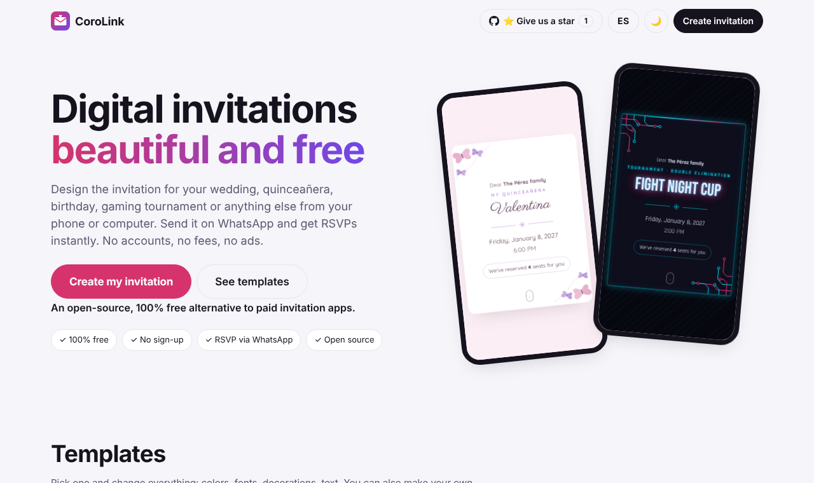
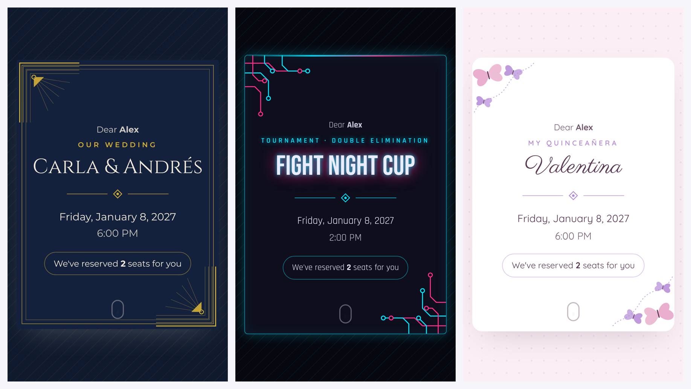
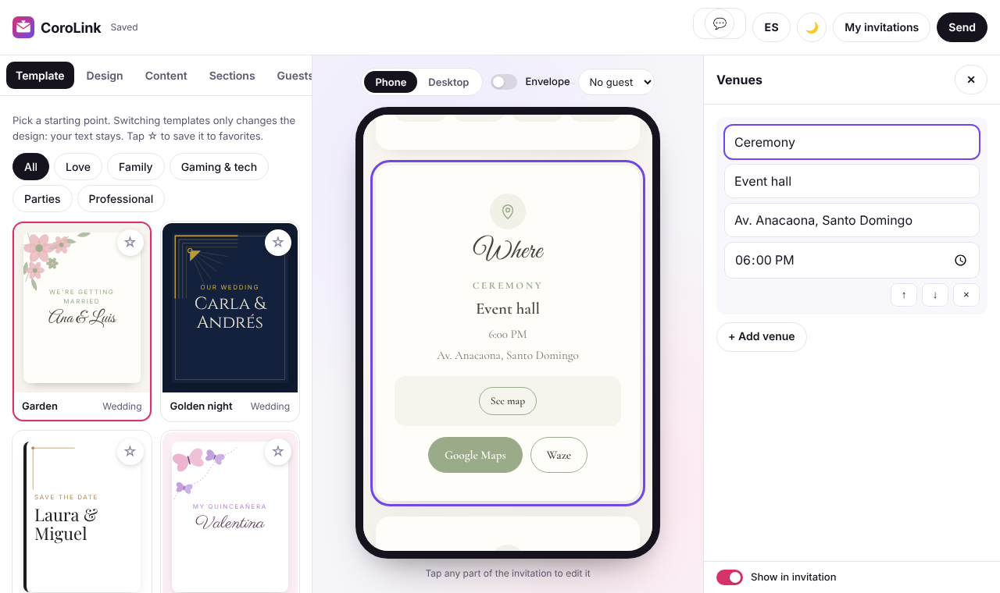
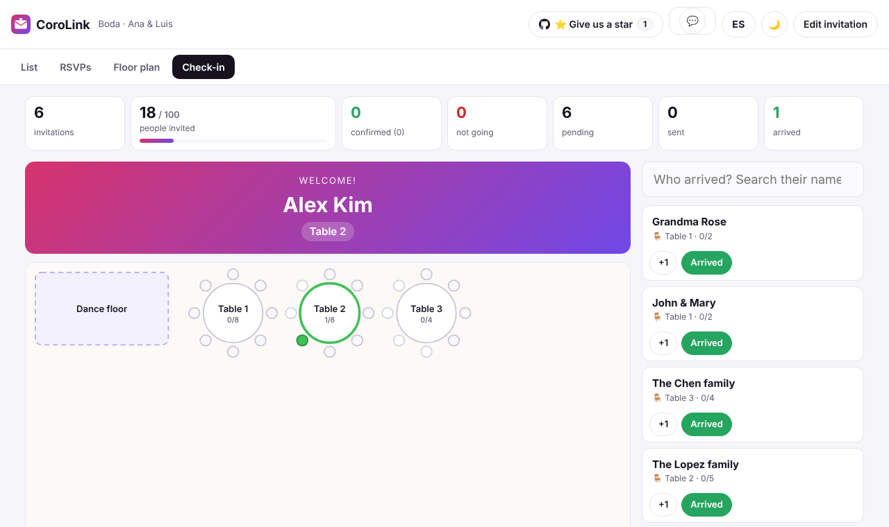

# 💌 CoroLink

### Beautiful digital invitations. 100% free. Open source.

**The free, open-source alternative to paid invitation apps like Invitio and others.**
Create an invitation, send it on WhatsApp and see who's coming, all from your phone or computer.

[**✨ Create your invitation →**](https://jhondydario.github.io/CoroLink/)

[Leer en español 🇪🇸](README.es.md) · [How it works (technical)](docs/TECHNICAL.md) · [Report a problem](https://github.com/JhondyDario/CoroLink/issues/new?template=bug_report.yml) · [Suggest an idea](https://github.com/JhondyDario/CoroLink/issues/new?template=feature_request.yml)

## Why CoroLink?

Most invitation apps charge you per event, lock features behind a paywall, or stop working when too many guests open your link. **CoroLink is free forever:** no account, no ads, no "premium" plan, no limits on how many people open your invitation.

## What you can do

**🎨 Make it look amazing**
- 33 ready-to-use templates for weddings, quinceañeras, birthdays, baby showers, graduations, **gaming tournaments, LAN parties**, Halloween, New Year's, BBQs, conferences and more
- Change colors, fonts and decorations, or tap any part of the preview to edit it
- Free photos and music built in (Creative Commons), or upload your own
- Add your Spotify playlist
- Save your favorite templates, turn your own invitations into templates, and duplicate past events

**💌 Send it in seconds**
- Every guest gets a personal link with their name, number of seats and table
- Send on WhatsApp with one tap, download a QR code to print, or share the cover as an image
- An animated envelope with their name opens the invitation

**✅ Know who's coming**
- Guests confirm with one tap and the answer arrives in your WhatsApp
- You decide what they fill in: plus-ones, allergies, a song request, or your own question
- The guest manager reads the confirmations for you and keeps the count

**🪑 Plan the big day**
- A virtual floor plan: add tables, drag them around, and auto-seat guests by group
- Event-day check-in: mark arrivals and watch the room fill up live, with a "Welcome, table 5!" screen for the entrance

**🌍 Works for everyone**
- Spanish and English (each invitation can be in either language)
- Dark mode
- Works on phones, tablets and computers. Nothing to install

## How is it free?

Your invitation **lives inside the link itself**. There's no server storing it and no database to pay for, so it costs nothing to run and your guest list stays private on your device.

| | |
|---|---|
|  |  |
| **Editor:** tap any part of the invitation to edit it | **Check-in:** see who's arrived and where they sit |

## Good to know

- Your drafts are saved in the browser you use. To move them to another device, use **Send → Export invitation**.
- Up to 100 guests per event.
- To receive confirmations automatically you paste the WhatsApp messages into the guest manager (it reads them for you).

## Help make it better

CoroLink is built in the open, and every idea counts.

- ⭐ **[Star the project](https://github.com/JhondyDario/CoroLink)** so more people find it
- 🐞 **[Report a problem](https://github.com/JhondyDario/CoroLink/issues/new?template=bug_report.yml)**
- 💡 **[Suggest an idea](https://github.com/JhondyDario/CoroLink/issues/new?template=feature_request.yml)**
- 🛠️ **Contribute code or templates:** see [CONTRIBUTING.md](CONTRIBUTING.md)

## License

[MIT](LICENSE). Free to use, change and share.

Made in the Dominican Republic 🇩🇴
